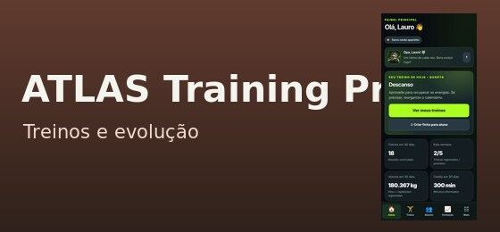

# Lauro Pimentel

Crio aplicativos web para rotina, treinos e operações de logística. Em Fortaleza, trabalho com apoio ao planejamento operacional e indicadores. Uso IA como ferramenta de desenvolvimento e reviso e testo o que entrego.

[LinkedIn](https://www.linkedin.com/in/lauro-pimentelgb/)

## Projetos em destaque

| Projeto | O que você encontra | Links |
| --- | --- | --- |
| **Kairós** | Tarefas, agenda, hábitos, estudos e metas em um app instalável que funciona offline. | [Abrir app](https://lauropimentel24-gb.github.io/kairos/) · [Código](https://github.com/lauropimentel24-gb/kairos) |
| **ATLAS Training Pro** | Registro de treinos, evolução por exercício, fichas de alunos e backup opcional com Supabase. | [Abrir app](https://lauropimentel24-gb.github.io/atlas-training-pro/) · [Código](https://github.com/lauropimentel24-gb/atlas-training-pro) |
| **Controle de estoque e contêineres** | Painel para estoque e devolução de contêineres vazios, com validação ISO 6346, relatórios em PDF e modo TV. | Projeto privado · [Solicitar demo no LinkedIn](https://www.linkedin.com/in/lauro-pimentelgb/) |

## Tecnologias

- **Interface e lógica:** HTML, CSS e JavaScript.
- **Instalação e acesso offline:** PWA, manifest e service worker.
- **Dados e relatórios:** Supabase, jsPDF e SheetJS.
- **Versionamento e publicação:** Git e GitHub Pages.

## Formação

Estudo desenvolvimento de software, programação web e banco de dados na Descomplica Faculdade Digital. Minha formação complementar inclui DevOps Strategist e Lean Seis Sigma Yellow Belt.

Para conversar sobre oportunidades ou projetos, [fale comigo no LinkedIn](https://www.linkedin.com/in/lauro-pimentelgb/).
