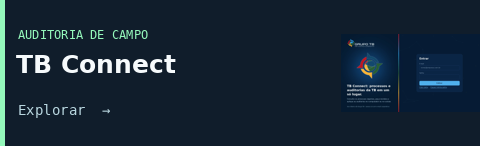
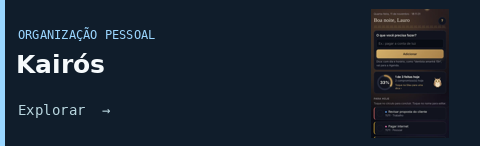
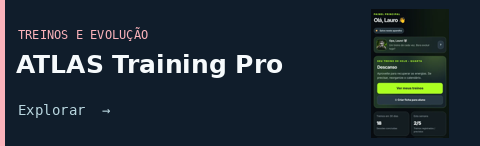
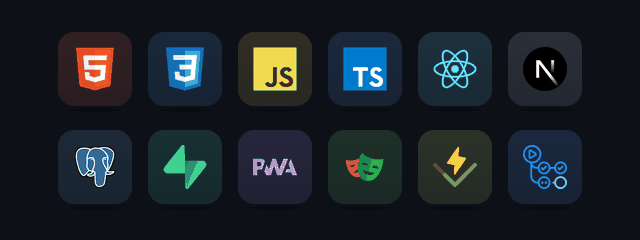

<a href="https://lauro-pimentel.rhythmicmound8.chatgpt.site/"><picture><source media="(prefers-reduced-motion: reduce)" srcset="assets/arcade/estudio.png"></picture></a>

Formado em desenvolvimento full stack pela **OneBitCode**. Curso **Análise e Desenvolvimento de Sistemas** na Faculdade Descomplica e estudo **Engenharia de IA** na DascIA.

[Portfólio](https://lauro-pimentel.rhythmicmound8.chatgpt.site/) · [LinkedIn](https://www.linkedin.com/in/lauro-pimentelgb/) · [E-mail](mailto:lauropimentel24@gmail.com)

<a href="https://lauropimentel24-gb.github.io/lauropimentel24-gb/arcade/"><picture><source media="(prefers-reduced-motion: reduce)" srcset="assets/arcade/arcade.png"></picture></a>

[▶ Jogar com teclado ou toque e explorar os quadradinhos](https://lauropimentel24-gb.github.io/lauropimentel24-gb/arcade/)

## Projetos

<strong>Como construímos o TB Connect</strong>

Fundei o TB Connect para facilitar as auditorias de campo do Grupo TB. Desenvolvi a plataforma com Arthur. Quem audita pode consultar procedimentos, preencher checklists e registrar fotos mesmo quando perde o sinal. Os registros são sincronizados quando a conexão volta.

Usamos React, Next.js e TypeScript na interface, PostgreSQL para os dados e Playwright para testar fluxos como a perda de conexão. [Ver demonstração e decisões técnicas](https://lauro-pimentel.rhythmicmound8.chatgpt.site/#tb-connect)

<strong>Explorar o código dos apps públicos</strong>

- [Kairós](https://github.com/lauropimentel24-gb/kairos) reúne agenda, estudos e hábitos em um app instalável que funciona offline.
- [ATLAS Training Pro](https://github.com/lauropimentel24-gb/atlas-training-pro) registra treinos e organiza fichas de alunos, com backup opcional no Supabase.

<h2 align="center">Tecnologias e ferramentas</h2>

  <a href="https://lauro-pimentel.rhythmicmound8.chatgpt.site/#tecnologias">
    <picture>
      <source media="(prefers-reduced-motion: reduce)" srcset="assets/stack/ola.png">
      
    </picture>
  </a>

