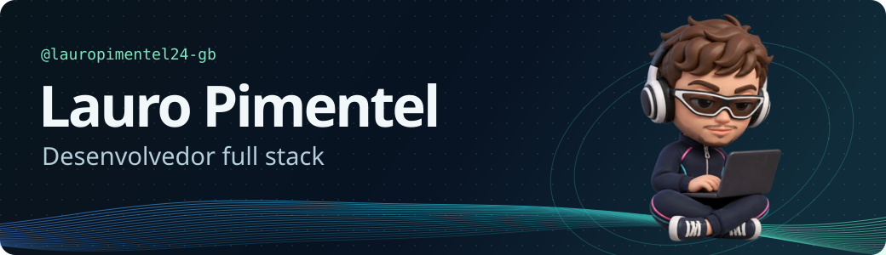

Sou desenvolvedor full stack formado pela **OneBitCode**. Curso **Análise e Desenvolvimento de Sistemas** na Faculdade Descomplica e estudo **Engenharia de IA** na DascIA.

[Portfólio](https://lauro-pimentel.rhythmicmound8.chatgpt.site/) · [LinkedIn](https://www.linkedin.com/in/lauro-pimentelgb/) · [E-mail](mailto:lauropimentel24@gmail.com)

## TB Connect

Fundei o **TB Connect** para facilitar as auditorias de campo do Grupo TB. Desenvolvi a plataforma com Arthur. A equipe consulta procedimentos oficiais, preenche checklists e registra fotos mesmo quando perde o sinal. Ao recuperar a conexão, o sistema sincroniza os registros.

**Next.js · React · TypeScript · PostgreSQL · Playwright**

[Ver a interface e explorar os fluxos no portfólio →](https://lauro-pimentel.rhythmicmound8.chatgpt.site/#tb-connect)

## Outros projetos

| Projeto | O que desenvolvi | Experimente |
| --- | --- | --- |
| [**Kairós**](https://github.com/lauropimentel24-gb/kairos) | Um app instalável que reúne tarefas, agenda, estudos e hábitos e funciona offline. | [Abrir Kairós](https://lauropimentel24-gb.github.io/kairos/) |
| [**ATLAS Training Pro**](https://github.com/lauropimentel24-gb/atlas-training-pro) | Registro de treinos, fichas de alunos e acompanhamento da evolução por exercício. | [Abrir ATLAS](https://lauropimentel24-gb.github.io/atlas-training-pro/) |
| **Controle de Estoque CFS** | Painel de estoque e devolução de contêineres com validação ISO 6346, relatório de turno e modo TV. | [Abrir demonstração](https://lauro-pimentel.rhythmicmound8.chatgpt.site/projetos/controle-estoque-cfs/demo/index.html) |

## Ferramentas que uso

 &nbsp;
 &nbsp;
 &nbsp;
 &nbsp;
 &nbsp;
 &nbsp;
 &nbsp;
 &nbsp;

Uso React, Next.js e TypeScript na interface, PostgreSQL e Supabase na camada de dados e Playwright, Vitest e GitHub Actions para testar e integrar mudanças.
